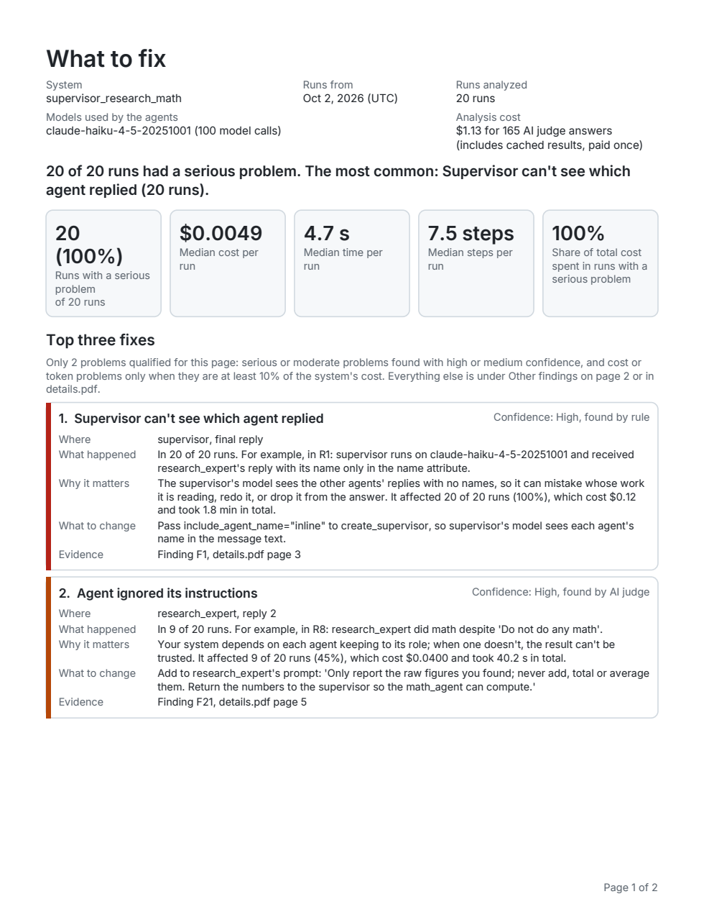

# tracedoc

tracedoc finds out why your LangGraph agents fail, and what to change. Point it at traces of
your agents' runs and it writes a short PDF report: the problems it found (blank answers, runs
that error out or loop, agents that ignore their instructions or each other's work, answers
the tools don't back up), the agent and step where each one happened, how often and at what
cost, and the change most likely to fix it. It is for developers building single- or
multi-agent systems with LangGraph. It runs on your own machine: your traces stay there, the
rule checks need no model at all, and the optional AI checks use your own model key.



*Page 1 of the [demo report](examples/langgraph-supervisor/): LangChain's own supervisor
example, whose supervisor gave a blank answer in 16 of 20 runs. tracedoc traced it to one
setting; changing it took blank answers to 0 of 20.*

Status: early release (0.0.1). Expect rough edges, and please
[report them](https://github.com/Kavinkuppal/tracedoc/issues/new/choose).

## Quickstart

You need Python 3.10 or newer.

**1. Install.**

```bash
python3 -m venv .venv          # Windows: py -m venv .venv
source .venv/bin/activate      # Windows: .venv\Scripts\activate
pip install "git+https://github.com/Kavinkuppal/tracedoc.git"
```

**2. Run the demo.** No API key, no cost. The demo's traces are in this repository:

```bash
git clone https://github.com/Kavinkuppal/tracedoc.git
tracedoc analyze tracedoc/examples/langgraph-supervisor/traces --no-judge --out demo-report
```

Open `demo-report/summary.pdf` (macOS: `open demo-report/summary.pdf`, Linux: `xdg-open`,
Windows: `start`). With `--no-judge` only the rule checks run, and they find the setting
behind the blank answers in all 20 runs. The [demo's README](examples/langgraph-supervisor/)
explains the example, and its `summary.pdf` is the full report, made with the AI judge too.

**3. Analyze your own agent.** Record its runs with the `TraceCapture` callback, which writes
one file per run:

```python
from tracedoc import TraceCapture

result = app.invoke(inputs, config={"callbacks": [TraceCapture("./runs")]})
```

Here `app` is your compiled LangGraph graph. After a few runs:

```bash
tracedoc analyze ./runs --no-judge     # rule checks only: no key, no cost
```

To add the AI judge, [set up an API key](#set-up-your-api-key), then:

```bash
tracedoc estimate ./runs               # what it would cost; no model calls
tracedoc analyze ./runs                # shows the estimate and asks before spending
```

Reports go to `./tracedoc-report/` (change it with `--out`). Traces from several systems
(several top-level graphs) get one report each, in sub-folders named after each graph.

Already tracing with LangSmith? Install with the LangSmith extra and read your project
directly (this needs `LANGSMITH_API_KEY`):

```bash
pip install "tracedoc[langsmith] @ git+https://github.com/Kavinkuppal/tracedoc.git"
tracedoc analyze --source langsmith --project my-project
```

`tracedoc analyze exported-runs.json --source langsmith` reads a LangSmith export instead, with
no key: a JSON list of runs, `{"runs": [...]}`, or one run per line, including every child run.

## Set up your API key

The AI judge uses **your own** model key. tracedoc never ships with, defaults to, or falls back
on anyone else's, and the cost goes to your provider account. It reads keys only from
environment variables:

| Provider | Environment variable |
| --- | --- |
| Anthropic (the default) | `ANTHROPIC_API_KEY` |
| OpenAI | `OPENAI_API_KEY` |

```bash
export ANTHROPIC_API_KEY="your-key"           # Windows PowerShell: $env:ANTHROPIC_API_KEY = "your-key"
```

- **Check the cost first.** `tracedoc estimate ./runs` prints what analysis would cost without
  calling any model. `tracedoc analyze` shows the same estimate and asks before it spends
  anything. `--max-cost 2` stops judging before spend passes $2.
- **Models.** By default a fast model screens each candidate (`claude-haiku-4-5-20251001`) and a
  stronger one confirms what it flags (`claude-sonnet-5-5`), asked twice independently. The
  [demo report](examples/langgraph-supervisor/) cost $1.13 for 20 runs.
- **Reruns are free.** Every answer is cached on your disk, so analyzing the same traces again
  reuses them and gives the same report. `--no-cache` asks the models again.
- **OpenAI or local models.** Set the provider and models in your [config file](#configuration).
  For a local OpenAI-compatible server such as Ollama or vLLM, set `provider =
  "openai_compatible"` and `base_url`; it gets no key unless you name one with `api_key_env`.
  Only Anthropic models have built-in prices, so add others under `[prices]` to get estimates.
- **Keep keys out of files.** tracedoc refuses a key written in its config file. Never commit a
  key to a repository.

## What the report contains

- **`summary.pdf`**, two pages.
  - **Page 1, What to fix:** the system, dates, runs and models; a one-sentence verdict; a
    scorecard (runs with a serious problem, median cost, time and steps per run, and the share
    of cost spent in runs with a serious problem); and the top three fixes. Each fix says
    where it happened (agent and step), what happened, why it matters, what to change, how
    confident the finding is, and where its evidence is.
  - **Page 2, Where and how often:** a map of your agents and their handoffs, shaded by how
    often each had a serious problem; a table of agents; the other findings; and what's
    working.
- **`details.pdf`**, the evidence, with no page limit: every finding, with excerpts from the
  trace (the request, the tool calls and results, the agent's output, any error); an index of
  every run; and a catalog of every check.
- **`report.json`**, the full results, for scripts and CI.
- With `--html`, also an interactive `report.html` and a `report.md`.

Every finding says how it was found. **Rule checks** run without a model: blank or empty final
answers, runs that end in an error, loops and repeated calls, runs that take too many steps,
failing tools retried the same way, tool results the agent never used, answers stated without
any check, token hotspots, slow steps, and known framework pitfalls (such as the
langgraph-supervisor setting in the demo, with the library's documentation cited). The **AI
judge** confirms or dismisses rule findings that need judgment, such as an answer that states
facts no tool returned; with `--include-unvalidated` it also looks for problems no rule can see.
Each confirmation is asked twice, independently. When the two reviews disagree, the finding
is kept at low confidence.

A *serious problem* is a high-severity finding with high or medium confidence. Page 1 shows only
serious and moderate problems found with high or medium confidence; everything else is on page
2 or in `details.pdf`. All report text comes from a reviewed catalog. The model writes only three
short parts of an AI judge finding (what happened, what to change, and one quote from the
trace), which are checked before they reach the report. A suggested fix never tells an agent to
book, buy, pay, send, cancel or delete anything without asking the user first.

Reports include excerpts of your traces (after redaction), so share them only with people who
may see that data.

## What leaves your machine

- **With `--no-judge`, nothing.** Traces, reports and caches stay on your disk
  (`tracedoc paths` shows where).
- **With the AI judge, model calls to the provider you configured, with your key.** Each call
  holds a short window of one run: the user's request, the agents' system prompts, and a few
  steps around a finding. A few calls classify runs that tracedoc can't place on its own, with
  up to 500 characters of the request and the names of the graph's nodes.
- **With `--source langsmith --project`, requests to LangSmith** that download your runs.
- **Nothing else.** There is no telemetry. tracedoc includes code for sharing anonymized
  statistics, but it is **not enabled in this version**: it never asks and never sends
  anything. `tracedoc share --preview` shows what it would send.

**Redaction.** Before any check or model sees trace content, tracedoc replaces the values of
sensitive keys (`api_key`, `password`, `token`, `authorization`, `secret` and a few more) and
anything that looks like an email address, an `sk-...` API key, a GitHub token, an AWS key ID, a
bearer token, or a card number (digit runs that pass the card checksum). You can add your own
fields and patterns in the config file. `TraceCapture` files themselves hold your agents' raw
inputs and outputs, since redaction happens when tracedoc analyzes them: treat them like logs,
and keep them out of version control.

## Known limitations

- **LangGraph only.** tracedoc reads traces of LangGraph apps, recorded with `TraceCapture` or
  from LangSmith. Other agent frameworks aren't supported yet.
- **The AI judge is better at objective failures than at judgment calls.** It reliably finds a
  blank answer, an error, a loop, or a number no tool returned. It is weaker on questions such
  as whether an agent should have asked the user something, or stopped too early, and it can
  flag something that wasn't a problem. Eight judge checks of that kind stay off by default
  until their precision has been measured; `--include-unvalidated` turns them on anyway.
- **Tested on small systems so far**, including LangChain's example agents with fake tools.
  Real systems, with slow or failing services and long documents, will show problems these
  didn't.
- **Model answers vary a little from run to run.** The cache keeps a rerun on the same traces
  identical, but a fresh analysis can differ slightly.

## Report a false finding

If tracedoc flagged something that wasn't a problem, please tell me with the
[False finding form](https://github.com/Kavinkuppal/tracedoc/issues/new?template=false_finding.yml).
It asks what tracedoc said and why it was wrong. Copy only what's needed from your traces, with
private data removed.

You can also record your vote locally, with nothing uploaded:

```bash
tracedoc feedback F3 down        # the finding ID from details.pdf, then up or down
```

## Configuration

Settings come from built-in defaults, then your config file, then any file passed with
`--config`. `tracedoc paths` shows where the config file is on your machine (on macOS,
`~/Library/Application Support/tracedoc/config.toml`; on Linux, `~/.config/tracedoc/config.toml`;
on Windows, `%LOCALAPPDATA%\tracedoc\config.toml`). For example:

```toml
[llm]
provider = "anthropic"               # anthropic, openai, or openai_compatible
triage_model = "claude-haiku-4-5-20251001"
confirm_model = "claude-sonnet-5-5"
# base_url = "http://localhost:11434/v1"   # for openai_compatible
# api_key_env = "MY_LOCAL_KEY"             # the NAME of an environment variable, never a key

[prices."my-model"]                  # USD per million tokens, for estimates and --max-cost
input = 0.5
output = 1.5

[thresholds]                         # every rule threshold can be changed
loop_min_repeats = 3
step_limit = 25

[checks]
disabled = ["cost.latency_outlier"]

[redact]                             # replaces the default lists, so keep what you need
fields = ["api_key", "password", "token", "secret", "authorization", "customer_name"]
patterns = ['ACME-\d+']
```

## Troubleshooting

- **`Error: ANTHROPIC_API_KEY is not set.`** You ran `analyze` with the AI judge but no key. Set
  one ([see above](#set-up-your-api-key)), or use `--no-judge`.
- **`Error: The provider rejected ANTHROPIC_API_KEY (HTTP 401).`** The key is wrong, expired,
  or lacks access. tracedoc stops at the first rejected call, without writing a report.
- **`Error: The provider refused the call (HTTP 429 ...)`** A rate, spending or billing limit
  was reached, so tracedoc stopped at once. Answers made before that are cached: run the same
  command again later and it continues from there.
- **`Estimated cost: unknown (model not in price table)`** Add the model's prices under
  `[prices."model-name"]`. `--max-cost` needs them too.
- **`Judge checks disabled (8)`** Expected: those checks stay off until their precision is
  measured (see [Known limitations](#known-limitations)).
- **`Error: no traces found in ./runs`** Point tracedoc at the folder `TraceCapture` wrote to,
  or add `--source langsmith` for LangSmith exports.

## Contributing, security and license

- To work on tracedoc, see [CONTRIBUTING.md](CONTRIBUTING.md).
- Please report security problems privately, as described in [SECURITY.md](SECURITY.md).
- tracedoc is written and maintained by Kavin Uppal, and released under the MIT license
  ([LICENSE](LICENSE)). Third-party components and
  their licenses are listed in [THIRD_PARTY_NOTICES.md](THIRD_PARTY_NOTICES.md).
